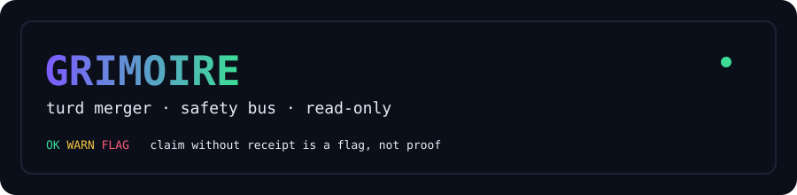

<p align="center">
  
</p>

<p align="center">
  
</p>

# turd-merger-tools — lean GRIMOIRE safety merger

Stay lean. Read-only by default. Stdlib only. No network unless you pass `llm`.

## What lives here

- `grimoire_safety.py` — merged safety checks:
  `.grimoire/sparks/spark_integrity.py` drift patterns +
  `Tribunal/test_flagger.sh` claim regex +
  `vigil/oler.py` anti-register families +
  receipt check (claim without receipt escalates) +
  `Merkaba/validator.py` SHIP-or-KILL gate (text-level, no yaml dep) +
  `tools/boundary/airlock.py` rule (mask secrets, never print them).
  Originals untouched; patterns vendored.
- `grimoire_tui.py` — read-only curses console (BUS · ROADMAP · ABOUT).
- `demo_svg.py` — renders the animated results SVG (SMIL, no JS).
- `roadmap_map.py` — indexes every `ROADMAP*.md` into one map.
- `ROADMAP_INDEX.md` — generated map (regen, don't hand-edit).
- `tests/` — deterministic unittest suite (temp dirs, no network).

## Use

```bash
python3 grimoire_safety.py bus --bus-dir ~/.grimoire/bus
python3 grimoire_safety.py scan ~/.grimoire/bus
python3 grimoire_safety.py validate ../Merkaba/outclaw.ba.yaml
python3 grimoire_safety.py llm notes.txt --image screenshot.png   # optional, sends to Gemini
python3 grimoire_tui.py                                          # or: grimoire (alias)
python3 demo_svg.py --root <project-dir> -o demo.svg             # keep --root narrow
python3 roadmap_map.py --root <project-dir> -o ROADMAP_INDEX.md
python3 -m unittest discover -s tests -v
```

Point `--root` at a project folder. A home-directory root walks far too much.

## Rules (from buffy_halp_lol.txt / GRIMOIRE SOUL)

- INTENDED vs EXECUTED vs OBSERVED vs VERIFIED stay separate.
- Missing evidence = UNKNOWN, never invented.
- Claim without receipt = WARN/FLAG, not proof.
- CLEAN sniff != true; CORRUPT sniff = demand evidence.
- Verdicts: `OK / WARN / FLAG / SKIP` + `SHIP / HOLD / KILL / NEEDS-REVIEW`.

## TM-0001

Merger TM-0001: GRIMOIRE safety bus. Status: INTEGRATED (not VERIFIED).
Sources pinned 2026-10-25. See `TURD_MERGER_QUICKLIST.md` for registry schema.
Full Tribunal boardroom (LLM) and Vigil full SDK stay OUT of the default path.
